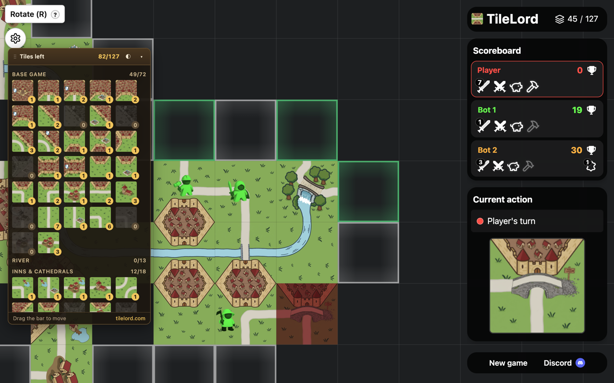

# Tile Counter for TileLord

A Chrome extension for [TileLord.com](https://tilelord.com), the free online Carcassonne-style tile-placement game. It adds a floating panel to every game that shows each tile still left in the deck.

## Features

- Every tile type with a live count of how many copies are left
- Total tiles left, plus a per-expansion breakdown
- Drag the panel anywhere; it remembers its position
- Collapse it, or hide tiles with none left
- Works on [tilelord.com](https://tilelord.com) only, with no permissions and no data collected

## Supported expansions (v1.0)

The deck changes with the expansions you turn on, so the extension carries the tile list for each one:

- Base game (including Abbot garden tiles)
- River and River II
- Inns & Cathedrals
- Traders & Builders
- Gold Mines
- Dragon & Fairy
- Festival
- Labyrinth

Tile multiplier (×2, ×3) is supported. Phantom and Abbot add no tiles.

## Install

- [Chrome Web Store](https://chromewebstore.google.com/detail/tile-counter-for-tilelord/amegfghiinhohplgfmgpnkenodmgfgjo)
- From source: clone this repo, open `chrome://extensions`, turn on **Developer mode**, click **Load unpacked** and pick this folder.

## How it works

The extension reads the board through TileLord's public `window.tlAgent.state()` hook, then subtracts placed tiles (and the tiles in your hand) from the deck for the game's expansions. `data.js` is generated from TileLord's tile specs with `tools/build-data.mjs`.

In strategy mode the count includes tiles held in your opponents' hands, since those are hidden.

## License

MIT
